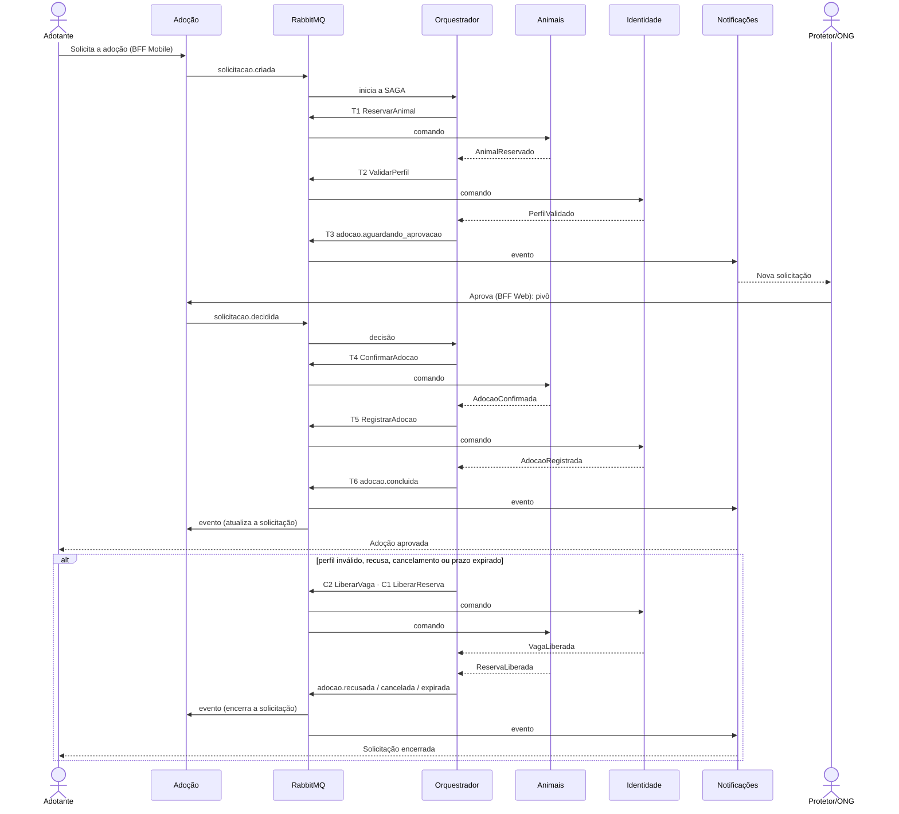
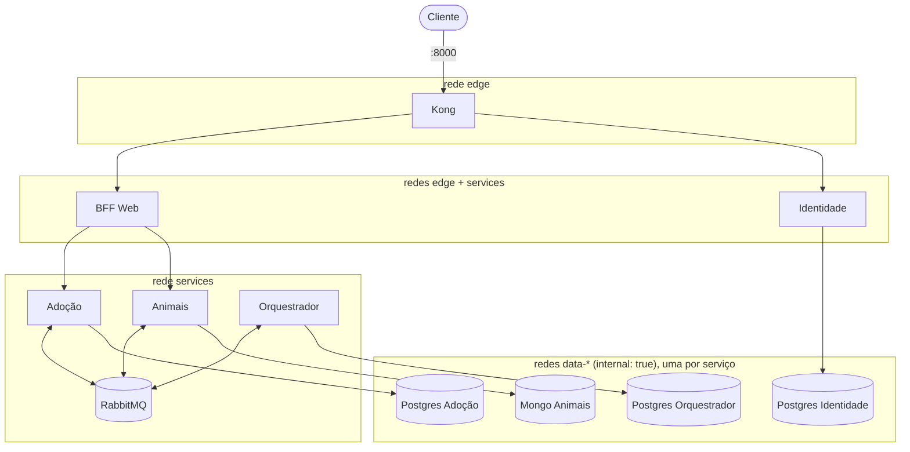

<p align="center">
  
</p>

# Ampara

**Conectando protetores, ONGs e adotantes para dar um novo lar a quem precisa.**

A Ampara é uma plataforma que organiza o caminho entre o registro de um animal perdido, achado ou disponível para adoção e o encontro de alguém disposto a cuidar dele. O projeto reúne protetores independentes, ONGs e adotantes em um fluxo único, com localização, acompanhamento e notificações.

> Projeto acadêmico desenvolvido para a disciplina de Sistemas Distribuídos. A Parte 1 (concepção e pitch) foi apresentada; agora o repositório concentra o projeto arquitetural da Parte 2 e o planejamento da implementação.

[Problema](#o-problema) · [Solução](#como-a-ampara-funciona) · [Arquitetura](#arquitetura) · [SAGA](#saga-de-adoção) · [Impacto](#impacto-social) · [Andamento](#andamento) · [Documentação](#documentação)

## O problema

Hoje, boa parte dos avistamentos, pedidos de resgate e anúncios de adoção circula em grupos de WhatsApp e redes sociais. A informação se perde, o alcance depende de compartilhamentos e não existe um fluxo comum entre quem encontra o animal, quem pode resgatá-lo e quem quer adotar.

Os dados ajudam a dimensionar esse cenário:

| Indicador | Dado |
| --- | ---: |
| Animais domésticos em situação de abandono no Brasil | cerca de **30 milhões** [1] |
| Animais sob tutela de ONGs e grupos de protetores | cerca de **185 mil** [2] |
| Organizações consideradas no levantamento do Instituto Pet Brasil | aproximadamente **400** [2] |

O abandono também está ligado a problemas comportamentais, mudanças na rotina do tutor e à diferença entre a expectativa e os cuidados que o animal realmente exige [3]. Embora maus-tratos sejam crime e tenham penas ampliadas pela legislação brasileira [4], a resposta cotidiana ainda depende muito do trabalho de organizações e voluntários.

## Como a Ampara funciona

1. Um animal perdido, encontrado ou disponível para adoção é cadastrado com fotos, espécie, porte, localização e status.
2. A plataforma permite encontrar animais próximos e, nas próximas entregas, avistamentos e denúncias.
3. Protetores e ONGs gerenciam os animais sob sua responsabilidade pelo App Web.
4. Adotantes pesquisam pelo App Mobile e enviam uma solicitação de adoção.
5. A solicitação passa por reserva, validação do perfil e aprovação do responsável pelo animal.
6. A plataforma notifica os envolvidos a cada mudança importante do processo.
7. Um assistente orienta o adotante sobre adoção responsável, com base em fontes confiáveis, e sugere animais compatíveis com a rotina dele.

### Quem usa

| Público | Cliente | Principais ações |
| --- | --- | --- |
| Protetores e ONGs | **App Web** | cadastrar animais, atualizar status e acompanhar solicitações de adoção |
| Adotantes | **App Mobile** | buscar animais por localização, solicitar adoção, receber notificações e consultar o assistente |

## Requisitos atendidos pela proposta

| Requisito da disciplina | Proposta da Ampara |
| --- | --- |
| 4 microsserviços independentes | 8 microsserviços: Identidade, Animais, Adoção, Notificações, Assistente (LLM), Orquestrador da SAGA, BFF Web e BFF Mobile |
| 1 banco por microsserviço | cada serviço com estado tem banco próprio, em instância própria: 3 PostgreSQL, 1 MongoDB, 1 Redis e 1 Qdrant (com cache Redis). Os BFFs não guardam estado |
| 2 clientes distintos | App Web (protetores e ONGs) e App Mobile (adotantes) |
| API Gateway e Backend for Frontend | Kong como entrada única e um BFF para cada cliente |
| Transação distribuída (SAGA) | adoção coordenada pelo **Orquestrador**, com comandos via RabbitMQ e compensações |
| Consistência e outbox | outbox em Adoção, Animais e Orquestrador para publicar mensagens sem dual write |
| CQRS | busca geográfica de animais servida por um banco de leitura separado do de escrita |
| LLM | RAG sobre guias de adoção responsável, LangChain com tool que consulta animais reais, e resiliência (circuit breaker, retry, cache e fallback) |

## Arquitetura

A Ampara é dividida em camadas, de cima para baixo:

1. **Clientes.** O App Web atende protetores e ONGs; o App Mobile atende adotantes.
2. **API Gateway (Kong).** É a única porta exposta: valida o JWT, aplica rate limit, gera o ID de correlação e encaminha cada rota externa (`/web/v1`, `/mobile/v1` e `/auth/v1`) ao serviço certo.
3. **Mensageria (RabbitMQ).** Fica logo abaixo do gateway como a camada comum a todos os microsserviços, inclusive os BFFs. Qualquer serviço pode publicar ou consumir mensagens nela sem conhecer o endereço dos outros. O gateway não se liga ao RabbitMQ: ele só encaminha HTTP (veja a observação abaixo do diagrama).
4. **Microsserviços.** São três grupos, todos implantados de forma independente:
   - **BFFs (borda):** um por cliente. Recebem a chamada do gateway, consultam os serviços de domínio por HTTP e devolvem a resposta no formato da tela: enxuta no mobile, completa no painel web. Também consomem eventos do RabbitMQ para atualizar a tela em tempo real. São microsserviços como os outros; a diferença é que não têm regra de negócio nem banco.
   - **Domínio:** Identidade, Animais, Adoção, Notificações e Assistente. Cada um é dono de uma parte do negócio e dos dados dela.
   - **Orquestrador:** coordena a SAGA de adoção. Não recebe chamadas dos clientes; trabalha só por mensagens.
5. **Dados.** Cada microsserviço com estado tem o próprio banco e ninguém lê o banco de outro serviço. Um dado de fora chega por uma chamada HTTP ou por um evento.


> **Por que não há seta entre o gateway e o RabbitMQ?** No diagrama, uma seta indica que um componente envia dados para outro, e o gateway não troca mensagens com o RabbitMQ. Ele recebe a requisição HTTP do cliente e precisa devolver a resposta nessa mesma conexão, então só encaminha para os BFFs (e para a Identidade, no login). Quem publica no RabbitMQ é o serviço dono do dado, na mesma transação do outbox, e o gateway não tem banco nem outbox. Além disso, o Kong OSS em modo DB-less não publica em filas AMQP. O RabbitMQ fica logo abaixo do gateway porque é a camada comum a todos os microsserviços, não porque o gateway fale com ele.

### Responsabilidade de cada microsserviço

| Microsserviço | Grupo | Tecnologia | Banco | Responsabilidade | Papel na SAGA |
| --- | --- | --- | --- | --- | --- |
| **BFF Web** | borda | Node.js | — | agrega dados para o painel de protetores e ONGs; consome `adocao.*` e `animal.*` para atualizar o painel em tempo real | encaminha a aprovação ou recusa do responsável para a Adoção |
| **BFF Mobile** | borda | Node.js | — | respostas enxutas e agregadas para o app do adotante; consome `adocao.*` para avisar o app em tempo real | encaminha o pedido de adoção para a Adoção |
| **Identidade** | domínio | Node.js / NestJS | PostgreSQL | cadastro, autenticação, perfil de adoção e verificação de protetores e ONGs | participante: valida o perfil, ocupa e libera a vaga do adotante |
| **Animais** | domínio | Python / FastAPI | MongoDB | cadastro, fotos, localização, status e reserva; busca por um banco de leitura separado (CQRS) | participante: reserva, libera a reserva e confirma a adoção |
| **Adoção** | domínio | Go | PostgreSQL | dados da solicitação, decisão do responsável e histórico mostrado ao usuário | inicia a SAGA e registra a decisão humana (o pivô) |
| **Notificações** | domínio | Python / FastAPI | Redis | avisos a cada etapa e caixa de notificações de cada usuário | consumidor: avisa adotante e responsável |
| **Assistente** | domínio | Python / LangChain | Qdrant + cache Redis | dúvidas sobre adoção responsável (RAG) e recomendação de animais compatíveis | não participa |
| **Orquestrador** | coordenação | Go | PostgreSQL | máquina de estados da SAGA, prazos, novas tentativas e compensações | coordenador: decide o próximo passo e quando compensar |

### Como os serviços conversam

- **HTTP (síncrono):** usado quando quem chama precisa da resposta para continuar. Os clientes falam só com o gateway, que encaminha aos BFFs (ou à Identidade, no login). Os BFFs chamam os serviços de domínio nas rotas internas `/v1`. O Assistente consulta Animais por uma tool de busca.
- **RabbitMQ (assíncrono):** usado quando quem envia não precisa esperar. São três exchanges:
  - `ampara.comandos`: o Orquestrador pede uma ação a um participante (por exemplo, `ReservarAnimal`);
  - `ampara.respostas`: o participante devolve o resultado ao Orquestrador (por exemplo, `AnimalReservado`);
  - `ampara.eventos`: fatos que já aconteceram, como `animal.criado` e `adocao.concluida`, consumidos por quem tiver interesse: Notificações, o projetor de Animais, a Adoção e os BFFs, que repassam a mudança para a tela aberta.
- **Outbox e inbox:** quem publica grava a mensagem na mesma transação do próprio dado (outbox), e um relay envia ao RabbitMQ depois. Assim, um dado salvo nunca fica sem a mensagem correspondente. Quem consome guarda o `messageId` já processado (inbox) e ignora reentregas. Mensagens que falham várias vezes vão para a DLQ.

### Onde entra a SAGA

A SAGA aparece no único fluxo que altera dados de vários serviços ao mesmo tempo: **a adoção**. Aprovar uma adoção exige reservar o animal (Animais), validar o adotante (Identidade), esperar a decisão do responsável (Adoção) e avisar as pessoas (Notificações). Não existe uma transação de banco que cubra quatro bancos diferentes. Por isso, cada passo é uma transação local, e cada passo que pode ser desfeito tem uma **compensação**.

Quem coordena é o **Orquestrador**, um microsserviço só para isso. A Adoção fica com o que o usuário vê (a solicitação e a decisão), e o Orquestrador fica com o controle do processo (qual passo está em andamento, o que fazer se um participante não responder e o que desfazer). O fluxo completo está na [próxima seção](#saga-de-adoção).

A separação entre Adoção e Orquestrador está na [ADR-008](docs/decisoes/ADR-008-orquestrador.md), e as mensagens trocadas entre eles (`solicitacao.*` e `saga.transicao`) estão no [catálogo](docs/contratos/eventos.md).

### CQRS em Animais: no banco, não só no código

Há duas formas de aplicar CQRS:

- **No código:** comandos (escrita) e consultas (leitura) ficam em classes e handlers separados, mas leem e gravam na mesma tabela ou coleção. A separação é só de organização.
- **No banco:** escrita e leitura usam bancos separados. A escrita grava no modelo completo, e um projetor alimentado por eventos monta um modelo pronto para a consulta. A leitura fica alguns segundos atrás da escrita (consistência eventual).

A Ampara aplica **CQRS no banco**, no serviço de Animais ([ADR-004](docs/decisoes/ADR-004-cqrs-animais.md)):

| | Escrita | Leitura |
| --- | --- | --- |
| Banco (MongoDB) | `animais` | `animais_leitura` |
| Quem usa | ONGs pelo BFF Web (cadastro, edição, status) | adotantes pelo BFF Mobile e o Assistente (busca por raio) |
| Conteúdo | documento completo: endereço e coordenadas exatos, histórico de status | dados públicos: localização arredondada em ~500 m, só bairro e cidade, nome e verificação da ONG já embutidos |
| Como é atualizado | pela API, na mesma transação do outbox | pelo projetor, que consome `animal.*` e `conta.verificada` do RabbitMQ |

O motivo não é só desempenho. O banco de leitura protege o endereço do animal (LGPD), evita chamar a Identidade a cada card da busca e deixa a defasagem visível na demonstração pelo campo `atualizadoEm`. Os dois bancos ficam na mesma instância do MongoDB, mas o serviço se conecta a eles por URLs diferentes (`ANIMAIS_MONGO_URL` e `ANIMAIS_LEITURA_MONGO_URL`). Mover a leitura para outra instância é só uma troca de configuração. Os detalhes estão em [`docs/cqrs.md`](docs/cqrs.md).

## SAGA de adoção

Uma adoção não pode ser concluída por uma única operação de banco: ela depende de dados e ações mantidos por serviços diferentes. O **Orquestrador** comanda a sequência. Ele grava o estado e o próximo comando na mesma transação (outbox), e os participantes respondem pelo RabbitMQ. Assim, a SAGA continua de onde parou mesmo que um serviço fique fora do ar por um tempo.



| Passo | O que acontece | Participante | Se der errado |
| --- | --- | --- | --- |
| T1 | reserva o animal | Animais | animal indisponível: encerra a solicitação sem compensar nada |
| T2 | valida o perfil e ocupa a vaga do adotante (1 solicitação ativa por vez) | Identidade | perfil inválido: C1 libera a reserva |
| T3 | avisa o responsável | Notificações | só reenvia; aviso não se desfaz |
| **Pivô** | o responsável aprova, recusa ou deixa o prazo de 72 h expirar | Adoção | recusa, cancelamento ou expiração: C2 libera a vaga e C1 libera a reserva |
| T4 | marca o animal como adotado | Animais | reenvia até dar certo |
| T5 | registra a adoção no histórico do adotante | Identidade | reenvia até dar certo |
| T6 | avisa adotante e responsável | Notificações | reenvia até dar certo |

O **pivô** é a aprovação humana. Antes dele, toda falha desfaz o que já foi feito, e o animal volta para a busca. Depois dele, os passos só são repetidos até dar certo, porque desfazer uma adoção aprovada não faz sentido para o negócio. Se um participante não responder no prazo, o Orquestrador reenvia o comando ou compensa. Os participantes ignoram comandos repetidos (inbox) e recusam comandos que chegam depois de uma compensação. Os estados, as transições e os cenários de falha estão em [`docs/saga.md`](docs/saga.md).

## Por que essa divisão

- **Identidade** concentra autenticação e perfis sem expor esses dados aos demais bancos.
- **Animais** mantém informações com estrutura variável, como características, fotos e localização, e separa a busca intensa do mobile das poucas escritas das ONGs.
- **Adoção** guarda a solicitação como o usuário a vê, sem misturar essa regra com o controle do processo distribuído.
- **Orquestrador** concentra o estado da SAGA, os prazos e as compensações em um só lugar: uma tabela mostra em que passo cada adoção está, e os participantes só precisam conhecer os próprios comandos.
- **Notificações** fica isolado do fluxo principal para que o envio de um aviso não determine sozinho o sucesso de uma operação de negócio.
- **Assistente** isola a latência, o custo e as falhas do modelo de linguagem: se ele cair, a busca e as adoções continuam funcionando.
- **BFFs** são microsserviços de borda: evitam que um cliente receba dados de que não precisa ou faça várias chamadas para montar uma tela, e cada um evolui no ritmo do próprio cliente.
- **RabbitMQ** é a camada comum a todos os microsserviços: reduz o acoplamento, permite que a SAGA sobreviva à indisponibilidade temporária de um participante e deixa os BFFs receberem mudanças sem consultar os serviços repetidamente.

## Impacto social

A Ampara pretende beneficiar animais em situação de abandono ou risco, ampliar o alcance de protetores e ONGs e tornar a busca dos adotantes mais organizada e transparente.

O impacto será acompanhado por quatro indicadores:

- adoções concluídas pela plataforma por período;
- tempo médio entre o registro de um avistamento ou denúncia e o resgate;
- tempo médio entre o cadastro do animal e a adoção;
- número de ONGs e protetores ativos e retenção mensal dessa rede.

## Andamento

| Etapa | Data | Situação |
| --- | --- | --- |
| Parte 1 — Concepção e pitch | 17/09 | apresentada |
| Parte 2 — Arquitetura | 22/10 ou 27/10 (repositório congela em 21/10 às 23h59) | em andamento |
| Parte 3 — Containerização e orquestração | 17/11 | em entrega ([detalhes](#containerização-e-orquestração-parte-3)) |
| Parte 4 — Sistema em funcionamento | 10/12 ou 15/12 (repositório congela em 09/12 às 23h59) | planejada |

As tarefas de cada etapa, com responsável e semana, estão no [board do projeto](https://github.com/users/mateus-vitor-ferreira-dev/projects/7).

### Situação de cada componente

| Componente | Pasta | Situação |
| --- | --- | --- |
| Adoção | [`services/adocao`](services/adocao) | implementado: solicitações, decisões e linha do tempo (espelho da SAGA via `saga.transicao`), outbox, DLQ, Dockerfile e manifests do k8s |
| BFF Web | [`bff/web`](bff/web) | implementado: Dockerfile e manifests do k8s |
| Animais | [`services/animais`](services/animais) | esqueleto (#39) e escrita com transições de status e outbox (#55); o projetor do CQRS na #56 |
| Notificações | [`services/notificacoes`](services/notificacoes) | base pronta (`/health`, testes, regras); o resto na #41 |
| Assistente | [`services/assistente`](services/assistente) | base pronta (`/health`, testes, regras); o resto na #42 |
| Identidade | [`services/identidade`](services/identidade) | esqueleto pronto (#98) |
| Orquestrador | [`services/orquestrador`](services/orquestrador) | implementado: SAGA extraída da Adoção (#140), outbox, inbox, prazos, DLQ, Dockerfile, compose e manifests do k8s |
| Gateway, BFF Mobile e apps | [`gateway`](gateway), [`bff/mobile`](bff/mobile), [`apps`](apps) | planejados; o README de cada pasta descreve o escopo |

Cada pasta tem um README com como rodar, a estrutura e o checklist do que falta. Os três serviços Python seguem o mesmo molde (`app/main.py` com `lifespan`, `config.py`, `dependencias.py` e a fixture `cliente` nos testes): quem conhece um sabe mexer nos outros.

## Como rodar

Precisa de Docker com o Compose. Na raiz do repositório:

```bash
cp .env.example .env
./scripts/gerar-chaves-jwt.sh      # par RS256 do JWT
# preencha as senhas no .env
docker compose up -d --build
```

Hoje o `compose.yaml` sobe os bancos, o RabbitMQ, a Adoção, o Orquestrador, Animais, a Identidade, Notificações, o Assistente e o BFF Web. Cada serviço entra no compose na própria issue de esqueleto. Para rodar só um serviço Python durante o desenvolvimento, siga o README da pasta dele. O cluster local está em [`k8s/`](k8s/README.md).

A CI roda em todo PR e push para a `develop` e a `main`: gitleaks, validação dos contratos e, para cada componente alterado, lint, testes e `docker build`. Nos serviços Python, isso é `ruff check`, `ruff format --check` e `pytest`.

## Containerização e orquestração (Parte 3)

O sistema roda de duas formas, com as **mesmas imagens**:

- **Docker Compose:** o ambiente de desenvolvimento. O `compose.yaml` sobe tudo com um comando.
- **Kubernetes (kind):** o ambiente orquestrado, com réplicas, Ingress, ConfigMaps, Secrets e escala. Os manifests ficam em [`k8s/`](k8s/README.md) e são organizados com kustomize.

Cada conceito do Compose tem um equivalente no Kubernetes:

| No Compose | No Kubernetes | Para que serve |
| --- | --- | --- |
| um bloco em `services:` | um `Deployment` (serviço sem estado) ou um `StatefulSet` (banco ou broker) | rodar o container com um número definido de réplicas |
| o nome do serviço numa rede | um `Service` ClusterIP | dar um endereço interno estável, como `http://adocao:8080` |
| o container do Kong com `kong.template.yml` | o Kong Ingress Controller e os recursos `Ingress` | a única entrada externa, com as mesmas rotas da Parte 2 |
| um `volume` nomeado | um `PersistentVolumeClaim` (`volumeClaimTemplates`) | guardar os dados do banco quando o pod morre |
| as variáveis `environment:` lidas do `.env` | um `ConfigMap` (configuração) e um `Secret` (credenciais) | tirar toda a configuração do código e da imagem |
| `healthcheck` e `depends_on` | `readinessProbe` e `livenessProbe` | só mandar tráfego para quem está pronto e reiniciar quem travou |

### Imagens: Dockerfile próprio e multi-stage

Cada serviço tem o próprio Dockerfile. Nos serviços que compilam código ou instalam dependências de build, o Dockerfile usa **multi-stage**: uma etapa tem compilador, TypeScript e dependências de desenvolvimento, e a etapa final recebe só o que roda em produção.

| Imagem | Etapas | Single-stage | Multi-stage | Ganho |
| --- | --- | ---: | ---: | ---: |
| `ampara/adocao` (Go) | `golang:1.23-alpine` → `distroless/static:nonroot` | 628 MB | 20,5 MB | −96,7% |
| `ampara/orquestrador` (Go) | `golang:1.23-alpine` → `distroless/static:nonroot` | 645 MB | 21,2 MB | −96,7% |
| `ampara/identidade` (NestJS) | `deps` → `build` → `runtime` em `node:22-alpine` | 511 MB | 325 MB | −36,4% |
| `ampara/bff-web` (Node/TS) | `deps` → `build` → `runtime` em `node:22-alpine` | 336 MB | 261 MB | −22,3% |
| `ampara/animais` (FastAPI) | `builder` com virtualenv → `runtime` em `python:3.12-slim` | 215 MB | 185 MB | −14,0% |

O ganho vai além do tamanho:

- **Menos superfície de ataque.** A imagem final não tem compilador, `npm` de desenvolvimento nem código-fonte TypeScript. Nos serviços em Go, a imagem distroless não tem nem shell: o próprio binário faz o healthcheck (`/adocao healthcheck`).
- **Deploy mais rápido.** Uma imagem menor sobe mais rápido para o cluster (`kind load`) e para um registry.
- **Cache de build.** As dependências (`go.mod`, `package*.json`, `requirements.txt`) são copiadas antes do código, então mudar uma linha de código não reinstala tudo.
- **Usuário sem root.** Todas as imagens finais rodam como usuário comum (`nonroot`, `node` ou `appuser`).

O ganho é menor em Node e Python porque o runtime da linguagem fica na imagem final: só o binário do `node` tem 123 MB. O `services/animais/Dockerfile.single` está no repositório para conferir a comparação. O método e as observações de cada imagem estão em [`docs/imagens.md`](docs/imagens.md).

As imagens de infraestrutura também são próprias, mas **não usam multi-stage, porque não têm etapa de build**. Elas só acrescentam configuração à imagem oficial:

- `ampara/rabbitmq` traz exchanges, filas e DLQs (`definitions.json`) e cria um usuário por serviço a partir das senhas recebidas;
- `ampara/mongo` sobe o MongoDB como replica set, que o outbox de Animais precisa para usar transações;
- `ampara/gateway` gera o `kong.yml` a partir de um template, colocando a chave pública do JWT na hora de subir.

### Compose: redes, volumes e um comando

```bash
cp .env.example .env && ./scripts/gerar-chaves-jwt.sh   # uma vez: senhas e chaves
docker compose up -d --build                            # o sistema inteiro
```

**Redes com isolamento entre camadas.** Cada camada só alcança a camada vizinha:



| Rede | Quem está nela | Por quê |
| --- | --- | --- |
| `edge` | gateway, BFF Web e Identidade | o gateway só encaminha para os BFFs e, no login, para a Identidade |
| `services` | todos os serviços e o RabbitMQ | chamadas HTTP internas e mensageria |
| `data-<serviço>` | um serviço e o banco dele | `internal: true`: sem saída para a internet, e nenhum outro serviço alcança esse banco (*database per service*) |

O gateway não está na rede `services` e não enxerga nenhum banco. Só ele publica porta (`8000`). A única exceção é o painel do RabbitMQ, em `127.0.0.1:15672`, para desenvolvimento.

**Volumes.** Cada banco tem um volume nomeado e não perde dados num `docker compose down`: `pg-identidade`, `mongo-animais`, `pg-adocao`, `pg-orquestrador`, `redis-notificacoes` (com AOF), `qdrant-assistente` e `rabbitmq-data`. O `redis-assistente` não tem volume de propósito, porque é só cache das respostas do LLM.

**Ordem de subida.** Todo banco e o RabbitMQ têm `healthcheck`, e os serviços usam `depends_on: condition: service_healthy`. A Adoção só sobe com o Postgres pronto e o RabbitMQ já com os usuários criados. Cada container tem limite de memória.

**Variáveis.** Cada serviço recebe em `environment:` só as próprias variáveis, nunca o `.env` inteiro. Assim, um serviço comprometido não lê a senha do banco dos outros.

### Kubernetes: Deployments e Services

O cluster local usa kind com 1 control-plane e 2 workers ([`k8s/kind-config.yaml`](k8s/kind-config.yaml)), para que as réplicas fiquem em nós diferentes. Tudo fica no namespace `ampara` e sobe com `kubectl apply -k k8s/`. O passo a passo está em [`k8s/README.md`](k8s/README.md).

| Componente | Workload | Réplicas | Service | Banco |
| --- | --- | ---: | --- | --- |
| Adoção | Deployment | 2 | `adocao:8080` | StatefulSet `postgres-adocao` (PVC 1 Gi) |
| Orquestrador | Deployment | 2 | `orquestrador:8081` (só probes) | StatefulSet `postgres-orquestrador` (PVC 1 Gi) |
| BFF Web | Deployment | 2 | `bff-web:3010` | — |
| Identidade | Deployment | 2 | `identidade:3001` | StatefulSet `postgres-identidade` |
| Animais | Deployment | 2 | `animais:8001` | StatefulSet `mongo-animais` (replica set) |
| BFF Mobile | Deployment | 2 | `bff-mobile:3020` | — |
| Notificações | Deployment | 2 | `notificacoes:8002` | StatefulSet `redis-notificacoes` (AOF, PVC 1 Gi) |
| Assistente | Deployment | 2 | `assistente:8003` | StatefulSet `qdrant-assistente` (PVC 1 Gi) e Deployment `redis-assistente` (cache, sem volume) |
| RabbitMQ | StatefulSet | 1 | `rabbitmq:5672` | PVC 1 Gi |

Padrões que todos os manifests seguem:

- **Bancos como StatefulSet**, com `volumeClaimTemplates` e Service headless (`clusterIP: None`): o pod do banco mantém nome e volume quando é recriado.
- **Readiness em `/ready` e liveness em `/health`.** A readiness tira o pod do balanceamento se o banco cair. A liveness nunca aponta para `/ready`: com o banco fora, isso faria o pod reiniciar em loop sem resolver nada.
- **`topologySpreadConstraints`** espalha as réplicas pelos dois workers.
- **Segurança no pod:** `runAsNonRoot`, `readOnlyRootFilesystem`, `allowPrivilegeEscalation: false` e `capabilities: drop [ALL]`.
- **Recursos:** `requests` de CPU e memória para o scheduler e `limits` de memória.
- **Réplicas seguras para o relay do outbox:** com 2 réplicas, as duas leem o outbox com `SELECT ... FOR UPDATE SKIP LOCKED`, então cada uma pega um lote diferente e nenhuma mensagem é publicada duas vezes ([`docs/dados.md`](docs/dados.md)).

### Ingress: as rotas do gateway da Parte 2

Na Parte 2, o gateway Kong (DB-less) era a única porta de entrada. No Kubernetes, o mesmo papel fica com o **Kong Ingress Controller**, e cada rota do `gateway/kong.template.yml` virou um recurso `Ingress`. Os plugins são os mesmos e são aplicados por anotação:

| Rota externa | Destino (Service) | Plugins (`konghq.com/plugins`) |
| --- | --- | --- |
| `/auth/v1` | `identidade:3001` | rate limit de 20/min |
| `GET /mobile/v1/animais` (busca pública) | `bff-mobile:3020` | rate limit de 600/min, sem JWT |
| `/mobile/v1` | `bff-mobile:3020` | JWT e rate limit de 600/min |
| `/web/v1` | `bff-web:3010` | JWT e rate limit de 300/min |

Os plugins globais `correlation-id` e `cors` também continuam. O JWT é validado com a **chave pública** da Identidade, guardada num Secret com o label `konghq.com/credential: jwt`. O proxy do Kong é um NodePort (`30080`), que o kind publica em `localhost:8000`, a mesma porta do Compose. Com isso, o cliente não percebe diferença entre os dois ambientes.

### ConfigMaps e Secrets

Nenhuma credencial fica no código, na imagem ou no Git:

- **ConfigMap** guarda a configuração que não é segredo: URLs internas, prazos da SAGA (`ORQUESTRADOR_TIMEOUT_PASSO`, `ORQUESTRADOR_PRAZO_EXPIRACAO`) e a chave pública do JWT.
- **Secret** guarda URLs de banco com senha e credenciais do RabbitMQ. Ele é gerado pelo `secretGenerator` do kustomize a partir de um `secret.env` local, nunca de um YAML com a senha escrita.
- O `secret.env` é montado pelo [`scripts/k8s-prep.sh`](scripts/k8s-prep.sh) a partir do `.env` da raiz e está no `.gitignore`. No Git fica só o `secret.env.example`, com os nomes das chaves e sem valores.
- **Cada serviço recebe só a própria credencial.** O pod da Adoção vê `ADOCAO_DATABASE_URL` e `ADOCAO_AMQP_URL`. O usuário e a senha de superusuário do Postgres ficam só com o StatefulSet do banco. A chave **privada** do JWT vai só para a Identidade, que é quem assina os tokens.
- A CI roda o **gitleaks** em todo PR, que falha se aparecer uma credencial versionada.

### Demonstração de escalabilidade

O serviço escalado é o **Animais**, porque a busca do app mobile é a rota de leitura mais acessada.

```bash
kubectl scale deployment/animais -n ampara --replicas=3
kubectl get pods -n ampara -l app=animais -o wide       # pods espalhados pelos workers
DEMO_RATE_LIMIT_ELEVATED=true ./scripts/escala-demo.sh  # carga com hey, entrando pelo Ingress
```

O script manda 300 requisições para `localhost:8000/mobile/v1/animais`, sempre pelo Ingress e nunca direto para um pod. Ele lê em cada resposta o header `X-Animais-Served-By`, que diz qual réplica atendeu, e compara 1 réplica com 3. A evidência de distribuição de carga é que **as três réplicas aparecem na contagem e nenhuma atende mais de 50% das requisições**. Num notebook, as réplicas dividem a mesma CPU, então a vazão não precisa triplicar. Ao terminar, o script volta o Deployment ao número original de réplicas. O roteiro e a tabela com os resultados ficam em [`docs/escalabilidade.md`](docs/escalabilidade.md).

### Onde está cada critério da avaliação

| Critério | Onde ver |
| --- | --- |
| Dockerfiles e qualidade das imagens | `services/*/Dockerfile`, `bff/*/Dockerfile`, `gateway/Dockerfile`, `infra/*/Dockerfile` e [`docs/imagens.md`](docs/imagens.md) |
| Compose com volumes e redes | [`compose.yaml`](compose.yaml): blocos `networks:` e `volumes:` no fim do arquivo |
| Deployments e Services | `k8s/<componente>/deployment.yaml`, `service.yaml` e `*-statefulset.yaml` |
| Ingress e roteamento | [`k8s/gateway/ingress.yaml`](k8s/gateway/ingress.yaml) e [`k8s/kong/`](k8s/kong/), comparados com [`gateway/kong.template.yml`](gateway/kong.template.yml) |
| ConfigMaps e Secrets | `k8s/<componente>/configmap.yaml`, `secret.env.example`, `kustomization.yaml` e [`scripts/k8s-prep.sh`](scripts/k8s-prep.sh) |
| Escalabilidade | [`scripts/escala-demo.sh`](scripts/escala-demo.sh) e [`docs/escalabilidade.md`](docs/escalabilidade.md) |

> **Pendências conhecidas:** Notificações e Assistente ainda não têm `/ready` (#41 e #42), então a readiness deles aponta para `/health`. O multi-stage desses dois ainda não reduz o tamanho da imagem, porque as dependências atuais são só wheels prontos ([`docs/imagens.md`](docs/imagens.md)).

## Documentação

| Documento | Conteúdo |
| --- | --- |
| [Arquitetura técnica](docs/arquitetura.md) | camadas, limites dos serviços, comunicação, dados, SAGA, CQRS e diretrizes de implementação |
| [Dados](docs/dados.md), [SAGA](docs/saga.md) e [CQRS](docs/cqrs.md) | database per service, consistência eventual, o fluxo da adoção e o modelo de leitura de Animais |
| [Documento de concepção](docs/apresentacao/parte-1/Ampara_Documento_Parte1.pdf) e [pitch](docs/apresentacao/parte-1/ampara_pitch.pptx) | Parte 1: problema, referências, impacto social e proposta inicial |
| [Apresentação da Parte 2](docs/apresentacao/parte-2/README.md) | slides da arquitetura, com o PDF e o roteiro de quem apresenta cada parte |
| [Decisões arquiteturais](docs/decisoes/) | ADRs: arquitetura distribuída, SAGA orquestrada, outbox, CQRS em Animais, gateway e BFFs, versionamento |
| [Contratos](docs/contratos/README.md) | OpenAPI de Adoção, Animais, Identidade, BFF Web e BFF Mobile, catálogo de eventos e convenções |
| [Operação](docs/operacao/dlq.md) | como inspecionar e reprocessar a DLQ |
| [Requisitos](docs/requisitos.md) | requisitos das Partes 2 a 4, lacunas da arquitetura atual, histórias de usuário e MVP |
| [Planejamento](docs/planejamento.md) | escopo, divisão por integrante, cronograma, riscos e kickoff |
| [Board](https://github.com/users/mateus-vitor-ferreira-dev/projects/7) | tarefas por entrega, semana e integrante |

## Organização do repositório

```text
.
├── apps/              # front-ends web e mobile
├── bff/               # BFF Web e BFF Mobile
├── gateway/           # API Gateway, única porta exposta
├── services/          # adocao, orquestrador, animais, identidade, notificacoes, assistente
├── infra/             # imagens próprias do MongoDB e do RabbitMQ (definitions.json)
├── k8s/               # manifests do cluster local (kind + kustomize)
├── scripts/           # chaves do JWT, DLQ e roteiro da demo
├── docs/              # arquitetura, contratos, ADRs, requisitos e apresentações
├── compose.yaml       # o sistema inteiro com um comando
├── .env.example       # variáveis de ambiente, sem nenhum valor secreto
├── CONTRIBUTING.md
└── README.md
```

## Integrantes

| Integrante | GitHub |
| --- | --- |
| Gabriel Soares | [@gxbreus](https://github.com/gxbreus) |
| Gabriel Cantanhede | [@gabrlcant](https://github.com/gabrlcant) |
| Gabriel Nakazato | [@Gabriel-Nakazato](https://github.com/Gabriel-Nakazato) |
| Mateus Vitor | [@mateus-vitor-ferreira-dev](https://github.com/mateus-vitor-ferreira-dev) |

## Fluxo de contribuição

O desenvolvimento parte da branch `develop`. Cada funcionalidade deve ser criada em uma branch própria e integrada por pull request após revisão de outro integrante. As regras completas estão em [CONTRIBUTING.md](CONTRIBUTING.md).

## Referências

1. [AGÊNCIA BRASIL. Brasil tem cerca de 30 milhões de animais domésticos abandonados. Empresa Brasil de Comunicação (EBC), dez. 2025.](https://agenciabrasil.ebc.com.br/geral/noticia/2025-12/brasil-tem-cerca-de-30-milhoes-de-animais-domesticos-abandonados)
2. [INSTITUTO PET BRASIL (IPB). Levantamento nacional sobre animais abandonados ou resgatados sob tutela de ONGs e protetores. 2024.](https://web.archive.org/web/20250615212548/https://institutopetbrasil.com/fique-por-dentro/numero-de-animais-de-estimacao-em-situacao-de-vulnerabilidade-mais-do-que-dobra-em-dois-anos-aponta-pesquisa-do-ipb)
3. [CONSELHO REGIONAL DE MEDICINA VETERINÁRIA DO ESTADO DE SÃO PAULO (CRMV-SP). Revista de Educação Continuada em Medicina Veterinária e Zootecnia: pesquisa sobre fatores associados ao abandono de cães.](https://crmvsp.gov.br/animal-nao-e-brinquedo-adocao-ou-compra-de-um-pet-requer-planejamento/)
4. BRASIL. [Lei Federal nº 9.605, de 12 de fevereiro de 1998](https://www.planalto.gov.br/ccivil_03/leis/l9605.htm); [Lei Federal nº 14.064, de 29 de setembro de 2020](https://www.planalto.gov.br/ccivil_03/_ato2019-2022/2020/lei/l14064.htm).
5. Complementar: [COBASI CUIDA. Pesquisa Cenário de Abandono de Animais, 4ª edição, 2025.](https://blog.cobasi.com.br/pesquisa-cobasi-cuida-sobre-abandono-de-animais/)
