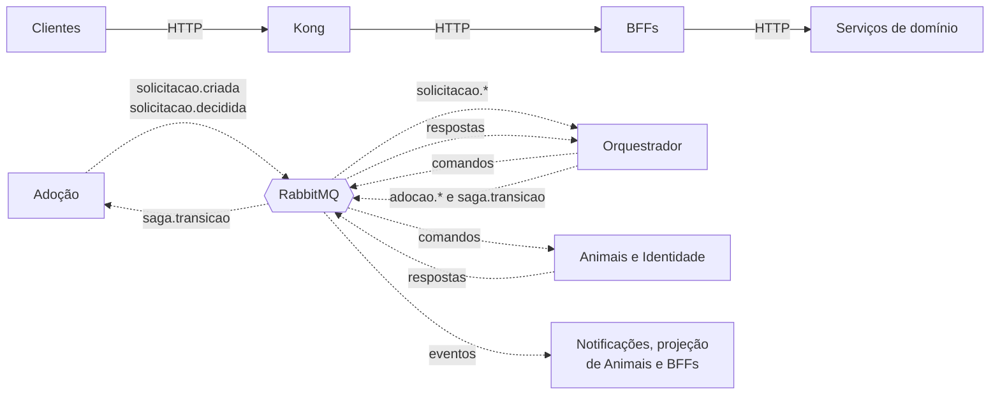

# Arquitetura da Ampara

A Ampara tem oito microsserviços: cinco de domínio (Identidade, Animais, Adoção, Notificações e Assistente), um Orquestrador dedicado à SAGA de adoção e dois BFFs, um por cliente. Todos ficam atrás de um API Gateway, e cada microsserviço com estado tem o próprio banco. A adoção atravessa quatro serviços numa SAGA coordenada pelo Orquestrador por mensagens no RabbitMQ.

Este documento mostra como as peças se encaixam e por que o sistema foi cortado assim. Os detalhes de cada mecanismo estão nos documentos da [última seção](#documentos-da-arquitetura).

## Restrições do projeto

- pelo menos quatro microsserviços independentes;
- um banco exclusivo por microsserviço;
- dois clientes com públicos diferentes;
- API Gateway e um Backend for Frontend por cliente;
- uma transação de negócio que atravesse pelo menos três serviços;
- CQRS em pelo menos um serviço;
- execução local reproduzível, no Docker Compose e no Kubernetes.

## 1. Componentes

O sistema é organizado em camadas, de cima para baixo:

| Camada | Componentes | O que faz | O que não faz |
| --- | --- | --- | --- |
| Clientes | App Web, App Mobile | telas de cada público | não chamam nenhum microsserviço diretamente |
| Gateway | Kong | valida o JWT RS256, aplica rate limit, CORS e correlation ID, roteia `/web/v1`, `/mobile/v1` e `/auth/v1` | não agrega dados, não tem regra de negócio e não troca mensagens com o RabbitMQ |
| Mensageria | RabbitMQ | camada comum a todos os microsserviços: comandos, respostas, eventos e DLX | não guarda estado de negócio |
| Microsserviços de borda | BFF Web, BFF Mobile | agregam os serviços de domínio numa resposta por tela e repassam eventos para a tela aberta | não têm banco nem regra de negócio |
| Microsserviços de domínio | Identidade, Animais, Adoção, Notificações, Assistente | regras de negócio e dados de cada parte do domínio | não leem o banco de outro serviço |
| Coordenação | Orquestrador | conduz a SAGA de adoção | não recebe chamadas dos clientes |
| Dados | um banco por microsserviço com estado | persistência | não é compartilhado |

> **Por que não há seta entre o gateway e o RabbitMQ?** No diagrama, uma seta indica que um componente envia dados para outro, e o gateway não troca mensagens com o RabbitMQ. Ele recebe a requisição HTTP do cliente e precisa devolver a resposta nessa mesma conexão, então só encaminha para os BFFs (e para a Identidade, no login). Quem publica no RabbitMQ é o serviço dono do dado, na mesma transação do outbox, e o gateway não tem banco nem outbox. Além disso, o Kong OSS em modo DB-less não publica em filas AMQP. O RabbitMQ fica logo abaixo do gateway porque é a camada comum a todos os microsserviços, não porque o gateway fale com ele.

Portas internas: Kong `:8000` (a única publicada), BFF Web `:3010`, BFF Mobile `:3020`, Identidade `:3001`, Animais `:8001`, Adoção `:8080`, Notificações `:8002` e Assistente `:8003`. O Assistente também chama Animais por HTTP (`GET /v1/animais/busca`), na tool de recomendação.

No [`compose.yaml`](../compose.yaml), as camadas viram redes. O gateway fica em `edge`. Os BFFs ficam em `edge` e em `services`, porque recebem do gateway e chamam os serviços; a Identidade também está em `edge` por causa do `/auth/v1`. Os serviços e o broker ficam em `services`, e cada banco fica numa rede interna `data-<serviço>` que só o próprio serviço alcança. Os serviços de domínio não têm rota externa: tudo entra pelo Kong ([ADR-005](decisoes/ADR-005-gateway-e-bff.md) e [`gateway.md`](gateway.md)). O Orquestrador e o `postgres-orquestrador` ainda não existem no compose (ver [pendências](#pendências-da-extração-do-orquestrador)).

### CQRS em Animais: no banco, não só no código

Há duas formas de aplicar CQRS. **No código**, comandos e consultas ficam em classes e handlers separados, mas leem e gravam a mesma coleção: a separação é só de organização. **No banco**, escrita e leitura usam bancos diferentes, e um projetor alimentado por eventos monta o modelo de leitura, que fica alguns segundos atrás da escrita.

A Ampara aplica **CQRS no banco** ([ADR-004](decisoes/ADR-004-cqrs-animais.md)). Por isso o `mongo-animais` aparece com dois databases: a escrita em `animais`, junto com o outbox, e a projeção de busca em `animais_leitura`. A versão só no código não resolveria o que motivou o padrão:

- a busca pública não pode expor endereço nem coordenadas exatas (LGPD), então a projeção guarda só a localização arredondada em ~500 m;
- cada card da busca mostra se a ONG é verificada, um dado da Identidade que o projetor embute a partir de `conta.verificada`, sem chamada HTTP por card;
- a busca do mobile tem muito mais tráfego que as escritas das ONGs e não disputa a coleção com as transações do outbox.

Os dois databases ficam na mesma instância no MVP, mas o serviço se conecta a eles por URLs separadas (`ANIMAIS_MONGO_URL` e `ANIMAIS_LEITURA_MONGO_URL`), então mover a leitura para outra instância é só configuração. Os modelos, a defasagem (p95 de até 5 s) e o rebuild estão em [`cqrs.md`](cqrs.md).

## 2. Comunicação

| Interação | Tipo | Por quê |
| --- | --- | --- |
| cliente → gateway → BFF → serviço | HTTP síncrono | o usuário espera a resposta na tela |
| Assistente → Animais (busca) | HTTP síncrono | a recomendação precisa dos animais disponíveis agora, dentro da mesma pergunta |
| Adoção → Orquestrador | eventos `solicitacao.criada`, `solicitacao.decidida` e `solicitacao.retomada` | a Adoção registra o pedido e a decisão humana sem depender de o Orquestrador estar no ar |
| Orquestrador → participantes da SAGA | comandos e respostas no RabbitMQ | a SAGA sobrevive a um participante fora do ar: o comando espera na fila e o Orquestrador compensa no timeout |
| Orquestrador → Adoção | evento `saga.transicao`, um por transição, com versão | a Adoção mantém o estado e a linha do tempo que as telas mostram, sem consultar o Orquestrador |
| Orquestrador → Notificações e BFFs | eventos `adocao.*` | Notificações avisa as pessoas e os BFFs atualizam a tela aberta |
| Animais → projeção de busca | eventos `animal.*` | a busca aceita alguns segundos de defasagem em troca de um modelo próprio para consultas por raio |
| Identidade → Notificações e Animais | evento `conta.verificada` | o aviso e a projeção não podem atrasar a verificação |

As rotas externas seguem `/<cliente>/v1` (`/web/v1`, `/mobile/v1` e `/auth/v1`), e as internas dos serviços, só `/v1`. São versões independentes: a Adoção pode publicar uma `v2` interna sem que o BFF Web deixe de expor `/web/v1` (ver [`gateway.md`](gateway.md#regra-das-urls-e-versões) e a ADR-006).

Toda mensagem sai pelo outbox do produtor e é deduplicada pela inbox do consumidor ([`dados.md`](dados.md), seção 5). Os nomes e formatos estão no [catálogo de mensagens](contratos/eventos.md).

## 3. Fronteiras dos serviços

Cada subseção diz pelo que o serviço responde, os dados que só ele possui, o que ele **não** faz e um corte alternativo que foi rejeitado.

### Identidade

*A escrever por @gxbreus. Deve incluir o corte rejeitado "um serviço único de usuários e animais".*

- **Responsável por:** …
- **Dados que possui:** …
- **Não faz:** …
- **Corte alternativo rejeitado:** …

### Animais

*A escrever por @gabrlcant.*

- **Responsável por:** …
- **Dados que possui:** …
- **Não faz:** …
- **Corte alternativo rejeitado:** …

### Adoção

- **Responsável por:** a solicitação de adoção como o usuário a vê: o pedido do adotante, a decisão do responsável (aprovar ou recusar), o cancelamento e a linha do tempo mostrada nas telas. Inicia a SAGA publicando `solicitacao.criada` e entrega o pivô ao Orquestrador em `solicitacao.decidida`. Atualiza a solicitação a partir dos `saga.transicao` do Orquestrador e aceita uma única decisão por solicitação.
- **Dados que possui:** solicitações, decisões, linha do tempo, o outbox, a inbox e as chaves de idempotência do `POST`. Guarda uma cópia do nome do animal e do responsável para as telas.
- **Não faz:** não conduz a SAGA: não envia comandos, não controla prazos e não decide compensações, o que é papel do Orquestrador. Não muda o status do animal nem ocupa a vaga do adotante. Não envia avisos: Notificações decide quem avisar e como.
- **Corte alternativo rejeitado: Adoção dentro de Animais.** A reserva fica em Animais, então juntar os dois parece natural. Só que a adoção também envolve a vaga do adotante, que é da Identidade, e uma espera humana de até 72 horas com estado próprio. Dentro de Animais, o catálogo, que muda pouco e é muito lido, passaria a carregar solicitações, decisões e prazos. Separados, cada um escala e falha sozinho: Animais pode ter 3 réplicas atendendo buscas sem mudar nada na adoção.
- **Corte alternativo rejeitado: Notificações dentro de Adoção.** Avisar parece só o último passo da adoção. Mas Notificações também atende `conta.verificada`, que não tem relação com adoção, guarda a caixa de entrada de cada usuário e tem outro padrão de falha: um aviso atrasado não pode segurar nem desfazer uma adoção.

### Orquestrador

- **Responsável por:** conduzir a SAGA de adoção: decide o próximo passo, envia os comandos aos participantes, controla os prazos (timeout de cada passo e as 72 horas da decisão), reenvia o que ficou sem resposta, dispara as compensações e retoma as SAGAs em andamento quando reinicia. Quando uma compensação esgota os reenvios, marca a SAGA para intervenção manual, e um ADMIN pode retomá-la depois de corrigir a causa ([`operacao/dlq.md`](operacao/dlq.md)).
- **Dados que possui:** o estado de cada SAGA, os passos com seus `messageId`, os prazos, o outbox, a inbox e a lista de `sagas_compensadas`.
- **Não faz:** não tem rota para os clientes nem dados que o usuário vê; não muda o status do animal, não ocupa a vaga do adotante e não envia avisos. Pede por comando e anuncia por evento.
- **Corte alternativo rejeitado: orquestração dentro da Adoção.** Era o desenho anterior, e o código atual ainda está assim. Funciona, mas mistura duas coisas que mudam por motivos diferentes: a regra da solicitação, que muda com o produto, e o controle do processo distribuído (prazos, reenvios, compensações), que muda com a infraestrutura. Também obriga a Adoção a atender as telas e a SAGA no mesmo processo, então uma sobrecarga num lado atrasa o outro. Separados, o estado da SAGA fica num só lugar, a Adoção vira um participante como os demais e cada um escala de acordo com a própria carga.

### Notificações

*A escrever por @Gabriel-Nakazato.*

- **Responsável por:** …
- **Dados que possui:** …
- **Não faz:** …
- **Corte alternativo rejeitado:** …

### Assistente

*A escrever por @Gabriel-Nakazato. Deve incluir o corte rejeitado "Assistente dentro de Animais" (ver também a ADR-007, #35).*

- **Responsável por:** …
- **Dados que possui:** …
- **Não faz:** …
- **Corte alternativo rejeitado:** …

### Borda: gateway e BFFs

O Kong é a única entrada: valida o JWT RS256, aplica rate limit, correlation ID e CORS, e não toma decisões de negócio nem troca mensagens com o RabbitMQ.

Os BFFs são **microsserviços**, implantados, versionados e escalados como os demais. Cada cliente tem o próprio BFF, que agrega os serviços numa resposta por tela. O BFF Web monta o painel da ONG com dados de três serviços, e o BFF Mobile entrega cartões enxutos para o adotante. Os dois também consomem `ampara.eventos` (`adocao.*` nos dois; `animal.*` no Web) e repassam a mudança à tela aberta por SSE ou WebSocket, sem consultar os serviços repetidamente. Não publicam comandos nem eventos de negócio. A decisão está na ADR-005, e a diferença entre as respostas em [`bff-comparacao.md`](contratos/bff-comparacao.md).

## 4. Propriedade dos dados

| Dado | Dono | Armazenamento |
| --- | --- | --- |
| contas, autenticação, perfil de adoção e vaga de solicitação | Identidade | `postgres-identidade` |
| animais, fotos, localização exata, status e reserva | Animais | `mongo-animais` (`animais`) |
| projeção de busca e cópia dos responsáveis verificados | Animais | `mongo-animais` (`animais_leitura`) |
| solicitações, decisões e linha do tempo | Adoção | `postgres-adocao` |
| estado da SAGA, prazos e compensações | Orquestrador | `postgres-orquestrador` |
| caixa de entrada de cada usuário | Notificações | `redis-notificacoes` (AOF) |
| base de conhecimento vetorial e cache de respostas | Assistente | `qdrant-assistente` e `redis-assistente` |

Os BFFs não guardam estado. Nenhum serviço acessa o banco de outro. Um dado externo chega por chamada HTTP interna ou por mensagem. A justificativa de cada banco e os pontos de consistência eventual estão em [`dados.md`](dados.md).

## 5. SAGA de adoção

A adoção é o único fluxo que altera dados de vários serviços: a reserva em Animais, a vaga na Identidade, a decisão na Adoção e os avisos em Notificações. Não existe transação que cubra quatro bancos, então cada passo é uma transação local com uma compensação, e o **Orquestrador** coordena a sequência por mensagens.

A divisão segue uma regra simples: **a Adoção é dona do que o usuário vê; o Orquestrador é dono do processo.**

1. O adotante pede a adoção pelo BFF Mobile. A Adoção grava a solicitação e publica `solicitacao.criada`.
2. O Orquestrador cria a SAGA, reserva o animal em Animais (T1), valida o perfil e ocupa a vaga na Identidade (T2) e avisa o responsável (T3).
3. O responsável decide pelo BFF Web. A Adoção grava a decisão e publica `solicitacao.decidida`. A aprovação é o **pivô**.
4. Depois do pivô, o Orquestrador confirma a adoção em Animais (T4), registra no histórico do adotante (T5) e avisa os dois lados (T6), reenviando cada passo até dar certo.
5. Antes do pivô, toda falha (animal indisponível, perfil inválido, recusa, cancelamento ou prazo expirado) desfaz o que já foi feito: libera a vaga (C2) e a reserva (C1).

A Adoção atualiza a solicitação a cada `saga.transicao`; Notificações e os BFFs consomem os eventos `adocao.*` para avisar e atualizar as telas. A máquina de estados, as 18 transições, os 18 cenários de falha e os diagramas de sequência estão em [`saga.md`](saga.md); a escolha de orquestrar por mensagens, na [ADR-002](decisoes/ADR-002-saga-orquestrada.md); e a separação entre Adoção e Orquestrador, na [ADR-008](decisoes/ADR-008-orquestrador.md).

## 6. Diretrizes para a implementação

1. Cada microsserviço com estado tem as próprias credenciais e o próprio banco.
2. Nenhum cliente acessa um serviço de domínio sem passar pelo gateway e por um BFF, exceto `/auth/v1`.
3. BFFs não têm regra de negócio: regras e autorização por recurso ficam nos serviços de domínio.
4. Só o Orquestrador envia comandos da SAGA, e ele grava o estado e o próximo comando na mesma transação, antes de avançar.
5. Comando e evento só saem pelo outbox; todo consumidor deduplica pela inbox.
6. Participantes recusam comandos que chegam depois de uma compensação.
7. Mensagens e logs da mesma solicitação carregam `sagaId` e `correlationId`.
8. Falha de Notificações, do Assistente ou de um BFF não altera o resultado já gravado da adoção.
9. Contratos HTTP e mensagens são versionados em `docs/contratos`, seguindo a ADR-006.

## 7. Decisões e consequências

| Decisão | Motivo | Consequência |
| --- | --- | --- |
| banco por serviço | autonomia e nenhum acoplamento pelo banco | consultas entre domínios exigem chamada ou evento |
| Orquestrador separado da Adoção | o controle do processo distribuído não se mistura com a regra da solicitação, e o estado da SAGA fica num só lugar | a Adoção vira participante e conversa com o Orquestrador por `solicitacao.*` e `saga.transicao`; um PostgreSQL a mais |
| SAGA orquestrada por mensagens | a SAGA sobrevive a um participante fora do ar | o Orquestrador precisa de outbox, inbox, timeouts e retomada |
| outbox e inbox | nenhuma mensagem se perde e nenhum efeito se repete | todo consumidor precisa ser idempotente |
| RabbitMQ como camada comum, sem ligação com o gateway | desacoplar produtores e consumidores; o gateway só encaminha HTTP e não tem o que publicar | consumidores precisam tratar reentrega e indisponibilidade temporária |
| CQRS no banco em Animais | LGPD, busca sem chamar a Identidade e carga de leitura separada da escrita | a busca mostra dados com alguns segundos de defasagem, e há um projetor para manter |
| gateway + um BFF por cliente, BFFs como microsserviços | os clientes precisam de respostas diferentes e os serviços não ficam expostos | dois microsserviços a mais para operar |
| BFFs consumindo eventos | atualizar web e mobile em tempo real sem consultas repetidas | filas próprias no `definitions.json` e SSE ou WebSocket com os apps |
| Assistente como serviço próprio | o LLM é lento, caro e falível; isolado, não derruba a busca nem a SAGA | mais um banco (vetorial) e uma chamada HTTP a Animais |
| arquitetura poliglota | a tecnologia adequada a cada responsabilidade | execução local e observabilidade precisam ser padronizadas |

## Estado da extração do Orquestrador

| O quê | Onde |
| --- | --- |
| decisão registrada | [ADR-008](decisoes/ADR-008-orquestrador.md) (#138, PR #143) |
| código: `services/orquestrador`, Adoção enxuta, filas, compose, k8s e CI | #140, PR #144 |
| `saga.md`, catálogo de mensagens, `dados.md` e roteiro da DLQ | #139, PR #145 |
| filas dos BFFs (`bff-web.eventos` e `bff-mobile.eventos`) e entrega por SSE ou WebSocket | #61 e #62 |

## Documentos da arquitetura

| Documento | Conteúdo |
| --- | --- |
| [`saga.md`](saga.md) | estados, transições, compensações e diagramas da SAGA |
| [`dados.md`](dados.md) | banco por serviço, consistência eventual, outbox e inbox |
| [`cqrs.md`](cqrs.md) | modelo de escrita, projeção de busca e defasagem em Animais |
| [`gateway.md`](gateway.md) | rotas externas e políticas do Kong |
| [`contratos/`](contratos/) | contratos OpenAPI de cada serviço e BFF, e o catálogo de mensagens |
| [`decisoes/`](decisoes/) | ADRs publicadas: arquitetura (001), SAGA (002), outbox (003), CQRS (004), gateway e BFFs (005), versionamento (006) e Orquestrador (008). Em andamento: Assistente (007, #35) |
| [`operacao/dlq.md`](operacao/dlq.md) | como identificar uma mensagem envenenada, reprocessar ou descartar e retomar a SAGA |
| [`compose.yaml`](../compose.yaml) e [`k8s/`](../k8s/) | execução local no Docker Compose e no Kubernetes (kind) |
