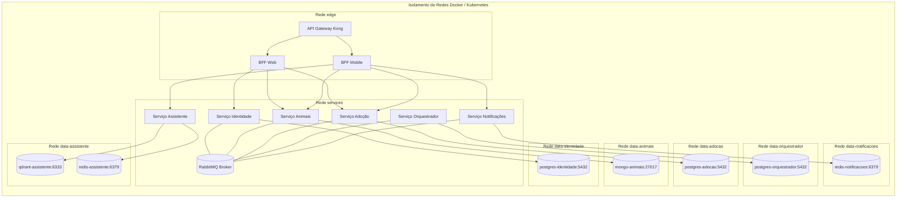
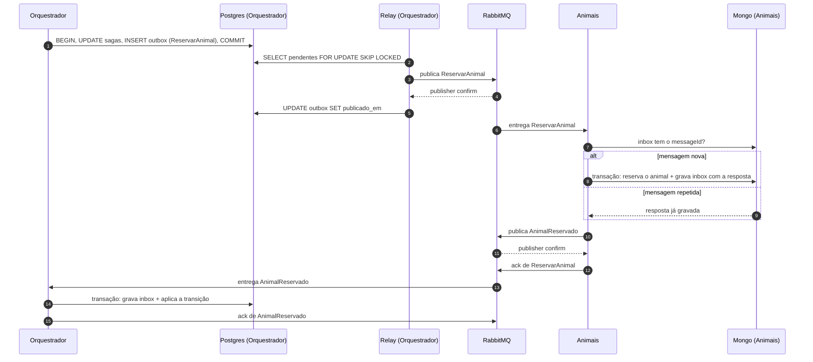

# Dados

Cada serviço da Ampara tem o próprio banco, e nenhum serviço lê o banco de outro. Este documento justifica cada banco, aponta onde a consistência é eventual e mostra como o outbox e a inbox resolvem a gravação dupla (*dual write*).

<!-- Seções 1 a 4: escritas na #31 (Gabriel Cantanhede). Seção 5: escrita na #32 (Mateus Vitor). -->

## 1. Um banco por serviço

Na Ampara, o padrão **Database per Service** é aplicado de forma estrita: cada microsserviço é proprietário absoluto de seu armazenamento de dados. Nenhum serviço possui permissão de leitura ou escrita direta no banco de outro serviço, e toda integração de dados entre fronteiras de domínio ocorre exclusivamente por APIs REST através dos BFFs ou de forma assíncrona por mensageria via RabbitMQ.

A escolha de cada tecnologia de banco foi guiada pelas necessidades reais das estruturas de dados e regras de negócio de cada microsserviço:

| Serviço | Container e Rede | Tecnologia | Dados armazenados | Por que esta tecnologia e não outra |
| :--- | :--- | :--- | :--- | :--- |
| **Identidade** | `postgres-identidade`<br>Rede: `data-identidade` | PostgreSQL 16 | `contas`, `perfis_adocao`, `vagas_solicitacao`, `adocoes_historico`, `sagas_compensadas`, `inbox`, `outbox` | **1. Integridade e unicidade relacionais estritas:** Validação de constraints em nível de banco (e-mail único via `UNIQUE`, exatamente 1 vaga de adoção ativa por adotante via constraint `UNIQUE (adotante_id)` na tabela `vagas_solicitacao`).<br>**2. Atomicidade ACID:** Suporte a transações relacionais atômicas para atualizar o perfil/vaga e registrar simultaneamente o evento no `outbox` e o `messageId` na `inbox`. |
| **Animais** | `mongo-animais` (replica set `rs0`)<br>Rede: `data-animais` | MongoDB 7.0<br>*(dois databases lógicos na mesma instância)* | **Escrita (`animais`):** `animais`, `outbox`, `inbox`, `responsaveis`, `sagas_compensadas`<br>**Leitura (`animais_leitura`):** `animais_busca` | **1. Esquema flexível para atributos variáveis:** Fotos em array, lista de traços de temperamento dinâmicos e histórico de status embutido como subdocumentos.<br>**2. Índice geoespacial esférico nativo:** Suporte maduro ao índice `2dsphere` em `pontoAproximado` no read model, permitindo ordenação e consultas por raio de distância geodésica (`$geoNear`) em milissegundos sem dependência de bancos externos como Elasticsearch.<br>**3. Transações multidocumento em replica set:** O cluster local roda com replica set `rs0` para viabilizar transações ACID no MongoDB, permitindo atualizar o animal e inserir o evento na coleção `outbox` na mesma operação atômica. |
| **Adoção** | `postgres-adocao`<br>Rede: `data-adocao` | PostgreSQL 16 | `solicitacoes` (com a decisão e o espelho do estado), `historico`, `outbox`, `inbox`, `idempotencia` | **1. Unicidade e decisão única:** um índice único parcial impede duas solicitações ativas do mesmo adotante para o mesmo animal, e o `SELECT ... FOR UPDATE` garante uma única decisão por solicitação.<br>**2. Outbox na mesma transação:** a solicitação, a decisão e a mensagem `solicitacao.*` são gravadas juntas, e o relay publica com `FOR UPDATE SKIP LOCKED`. |
| **Orquestrador** | `postgres-orquestrador`<br>Rede: `data-orquestrador` | PostgreSQL 16 | `sagas`, `saga_passos`, `saga_historico`, `outbox`, `inbox` | **1. Transações ACID fortes para máquina de estados:** como orquestrador da SAGA (ADR-008), precisa de consistência imediata e de um histórico auditável de passos (`saga_passos`), com locks pessimistas (`SELECT ... FOR UPDATE`) para serializar decisões, prazos e respostas concorrentes.<br>**2. Concorrência escalável no relay de outbox:** `FOR UPDATE SKIP LOCKED` permite que várias réplicas do relay processem lotes de comandos pendentes sem colisão nem duplicação. |
| **Notificações** | `redis-notificacoes`<br>Rede: `data-notificacoes` | Redis 7.2 com persistência AOF (`fsync everysec`) | `notif:caixa:{usuarioId}` (ZSET), `notif:item:{id}` (HASH), `notif:proc:{messageId}` (STRING com TTL) | **1. Baixíssima latência e ordenação nativa por timestamp:** A caixa de entrada in-app é modelada com Sorted Sets (`ZSET`), onde o score é o timestamp Unix da notificação. Isso permite entregar listagens paginadas e ordenadas cronologicamente (`ZREVRANGEBYSCORE`) em tempo $O(\log N + M)$ com consumo mínimo de memória.<br>**2. Expiração automática por TTL:** Notificações lidas antigas e chaves de idempotência da inbox (`notif:proc:{messageId}`) expiram sozinhas por TTL nativo da engine, eliminando jobs manuais de limpeza em batch.<br>**3. Durabilidade com AOF:** O modo Append-Only File com sincronização a cada segundo garante que notificações confirmadas sobrevivam ao reinício do container. |
| **Assistente** | `qdrant-assistente`<br>`redis-assistente`<br>Rede: `data-assistente` | Qdrant (vetorial) +<br>Redis 7.2 (cache em memória) | **Qdrant:** coleção `base_conhecimento` (chunks e embeddings)<br>**Redis:** chaves `assist:cache:{sha256}` | **1. Busca vetorial eficiente com filtros por metadados:** O Qdrant implementa indexação HNSW (*Hierarchical Navigable Small World*) com busca por similaridade de cosseno, permitindo filtrar simultaneamente por trechos e capítulos dos guias de adoção responsável.<br>**2. Cache volátil de respostas (64 MB LRU):** O Redis atua como armazenamento efêmero sem persistência de volume para armazenar respostas de perguntas idênticas (indexadas por SHA-256 do prompt), reduzindo o custo financeiro e a latência de chamadas à API da LLM. |

### 1.1 Isolamento de Redes e Acesso

Nenhum banco fica exposto na rede `services` ou na rede externa `edge`. Cada microsserviço conecta-se a duas redes: a rede `services` (para comunicação interna entre BFFs, serviços e o broker RabbitMQ) e a sua rede privada `data-*` (compartilhada exclusivamente entre ele e a sua respectiva instância de banco).



---

## 2. Pontos de consistência eventual

Como cada serviço possui seu próprio banco de dados e a comunicação assíncrona desacopla temporalmente os participantes, existem cinco pontos onde vigora a **consistência eventual**:

### 2.1 Busca de animais (Read Model do CQRS)
- **Onde:** BFF Mobile $\rightarrow$ Animais `GET /v1/animais/busca` (projeção `animais_leitura.animais_busca`).
- **Origem do dado:** Escrita em `animais.animais` $\rightarrow$ coleção `outbox` $\rightarrow$ relay publica evento `animal.criado` / `animal.atualizado` $\rightarrow$ fila `animais.projecao` $\rightarrow$ projetor atualiza `animais_busca`.
- **Defasagem aceitável:** $p95 \le 5\text{ s}$.
- **O que o usuário vê:** Um animal recém-cadastrado pela ONG ou com dados alterados no painel web pode demorar de 1 a 2 segundos para aparecer no mapa ou feed de busca do App Mobile. O timestamp `atualizadoEm` retornado no cartão evidencia a defasagem temporal.

### 2.2 Réplica local de responsáveis em Animais
- **Onde:** Serviço de Animais, coleção local `animais.responsaveis` (consultada antes de permitir que uma ONG cadastre animais).
- **Origem do dado:** Identidade marca conta como `VERIFICADA` no PostgreSQL $\rightarrow$ outbox $\rightarrow$ evento `conta.verificada` $\rightarrow$ projetor de Animais salva na réplica local `responsaveis`.
- **Defasagem aceitável:** $p95 \le 3\text{ s}$.
- **O que o usuário vê:** Um protetor ou ONG recém-verificado pelo administrador da plataforma pode receber erro de permissão por até 3 segundos se tentar cadastrar um animal imediatamente após a aprovação, até que a réplica local seja sincronizada.

### 2.3 Dados desnormalizados da ONG na projeção de leitura
- **Onde:** Projeção `animais_leitura.animais_busca` (campos `responsavel.nome` e `responsavel.verificado`).
- **Origem do dado:** Evento `conta.verificada` da Identidade $\rightarrow$ projetor de Animais executa atualização em lote em todos os documentos de `animais_busca` pertencentes àquela conta.
- **Defasagem aceitável:** $p95 \le 5\text{ s}$.
- **O que o usuário vê:** O selo de verificação da ONG passa a ser exibido nos cartões de busca sem nenhuma chamada síncrona à Identidade.
- **Risco de cópia desnormalizada (#90):** No MVP, assume-se como premissa de domínio que o nome do responsável é imutável. Alterações futuras de nome de usuário exigiriam a criação do evento `conta.atualizada` para atualizar os documentos projetados (item planejado para o pós-MVP, issue #90).

### 2.4 Status do animal durante a SAGA de Adoção
- **Onde:** App Mobile consultando `GET /mobile/v1/animais` ou `GET /mobile/v1/animais/{id}`.
- **Origem do dado:** o Orquestrador emite o comando `ReservarAnimal` $\rightarrow$ Animais grava status `RESERVADO` em `animais.animais` $\rightarrow$ outbox $\rightarrow$ evento `animal.status_alterado` $\rightarrow$ projetor atualiza `animais_busca`.
- **Defasagem aceitável:** $p95 \le 5\text{ s}$.
- **O que o usuário vê:** Enquanto a SAGA transiciona em segundo plano, outro adotante que pesquisar na mesma região pode enxergar o animal por alguns segundos antes dele sumir da lista de disponíveis (pois a busca filtra `DISPONIVEL`). Se esse segundo usuário tentar solicitar o pet antes da projeção atualizar, o comando da SAGA falhará de forma determinística na escrita com `409 Conflict` (`ANIMAL_JA_RESERVADO`), preservando a consistência do negócio.

### 2.5 Caixa de notificações do usuário
- **Onde:** App Mobile consultando `GET /mobile/v1/notificacoes` (armazenadas em `redis-notificacoes`).
- **Origem do dado:** Eventos de domínio emitidos pelo RabbitMQ (`adocao.iniciada`, `adocao.aguardando_aprovacao`, `adocao.concluida`, `adocao.recusada`) $\rightarrow$ consumidor assíncrono de Notificações grava o aviso no Redis.
- **Defasagem aceitável:** $p95 \le 3\text{ s}$.
- **O que o usuário vê:** O aviso no sininho de notificações do aplicativo chega de 1 a 2 segundos após a mudança de estado ser confirmada pelo Orquestrador ou pela ONG.

---

## 3. Riscos de dual write e cenários de falha

O problema da **gravação dupla (*dual write*)** ocorre quando uma operação precisa alterar o banco de dados relacional/NoSQL e simultaneamente publicar uma mensagem no broker RabbitMQ. Como banco e broker não participam de uma transação distribuída de duas fases (2PC/XA), uma falha no processo entre as duas chamadas gera inconsistência grave:

### 3.1 Orquestrador: Grava estado da SAGA e publica comando
- **Cenário de falha sem proteção:**
  - *Se gravar primeiro e cair antes de publicar:* O serviço altera a SAGA para `ANIMAL_RESERVADO` no PostgreSQL e cai. Ao reiniciar, o comando `ValidarPerfil` nunca foi enviado ao RabbitMQ: a SAGA congela para sempre e o animal fica bloqueado indefinidamente.
  - *Se publicar primeiro e a gravação falhar:* O comando `ValidarPerfil` é enviado à Identidade, mas a transação do Orquestrador sofre *rollback* (ex.: timeout de conexão ou falha de disco). A Identidade valida o perfil de uma SAGA que nunca avançou no banco do Orquestrador.
- **O mesmo risco na Adoção:** se ela gravasse a decisão do responsável e caísse antes de publicar `solicitacao.decidida`, a tela mostraria a decisão registrada e a SAGA nunca saberia dela. Por isso a Adoção também publica pelo outbox.
- **Mitigação:** Gravação do comando na tabela `outbox` dentro da **mesma transação relacional** do PostgreSQL (`BEGIN ... UPDATE sagas ... INSERT INTO outbox ... COMMIT`), com publicação assíncrona por relay com *publisher confirms* e `FOR UPDATE SKIP LOCKED` (detalhado na [Seção 5](#5-outbox-e-inbox) e issue #32).

### 3.2 Animais: Grava cadastro/edição e publica evento para o Read Model
- **Cenário de falha sem proteção:**
  - Uma ONG cadastra um animal em `animais.animais` e a aplicação cai antes de publicar `animal.criado` no broker. O animal existe na base de escrita, mas nunca chega à coleção `animais_leitura.animais_busca`: o animal torna-se um "fantasma" que nunca aparece na busca do celular.
- **Mitigação:** Gravação do evento na coleção `outbox` na **mesma transação multidocumento** do MongoDB em replica set `rs0` (`session.start_transaction()`), com publicação pelo relay de Animais (detalhado na [Seção 5.4](#54-animais-outbox-no-mongodb) e issue #32).

### 3.3 Identidade: Marca conta como verificada e publica evento
- **Cenário de falha sem proteção:**
  - O administrador aprova uma ONG e a conta passa para `VERIFICADA` no PostgreSQL. Se o processo cair antes de publicar `conta.verificada`, a réplica local `responsaveis` do serviço de Animais nunca tomará conhecimento da aprovação, impedindo a ONG de cadastrar animais.
- **Mitigação:** Outbox transacional obrigatório também no serviço de Identidade (PostgreSQL) garantindo que `conta.verificada` sempre seja entregue ao exchange `ampara.eventos` (detalhado na [Seção 5.1](#51-onde-ha-outbox)).

### 3.4 Respostas dos participantes da SAGA (Sem Outbox adicional)
As respostas dos participantes da SAGA (`AnimalReservado`, `PerfilValidado`, etc.) **não utilizam outbox**. Em vez disso, o participante grava a resposta pronta na tabela/coleção `inbox` na mesma transação atômica do efeito e publica com *confirm* antes de dar o `ack` do comando. Se cair antes do `ack`, o RabbitMQ reentrega o comando, o participante detecta o `messageId` na `inbox` e republica a mesma resposta gravada sem reexecutar o efeito (detalhado na [Seção 5.5](#55-inbox-nos-consumidores)).

### 3.5 Risco de quebra de isolamento no Broker (#89)
- **Cenário de risco:** Se todos os microsserviços utilizassem uma única credencial de administrador compartilhada no RabbitMQ (`guest:guest`), o isolamento de "Database per Service" seria ilusório na camada de rede: um serviço comprometido ou com bug poderia publicar respostas forjadas da SAGA (ex.: forjar um `AnimalReservado` falso) diretamente nas filas da Adoção.
- **Mitigação:** Cada microsserviço possui credenciais exclusivas e permissões mínimas no RabbitMQ configuradas via `infra/rabbitmq/definitions.json` (issue #89), garantindo que apenas Animais possa publicar na exchange de comandos e respostas de seu domínio.

---

## 4. Como isso será evidenciado na Parte 4

Na apresentação prática ao vivo e nos testes de homologação da Parte 4, o padrão **Database per Service** e a consistência eventual serão evidenciados de forma determinística:

1. **Evidência de Containers e Volumes Separados:**
   - Inspeção visual do `docker compose ps` e do Kubernetes demonstrando 5 containers de banco distintos:
     - `postgres-identidade` com volume `pgdata_identidade`;
     - `mongo-animais` com volume `mongodata_animais`;
     - `postgres-adocao` com volume `pgdata_adocao`;
     - `redis-notificacoes` com volume `redisdata_notificacoes`;
     - `qdrant-assistente` com volume `qdrantdata_assistente`.
2. **Teste de Isolamento de Redes (Network Segregation Test):**
   - Execução de comandos determinísticos comprovando que um serviço não alcança o banco do outro:
     ```bash
     # Tentativa do serviço Animais alcançar o PostgreSQL da Adoção (deve falhar com timeout/recusa de rede)
     docker compose exec animais python -c "
     import socket
     s = socket.socket()
     s.settimeout(2)
     try:
         s.connect(('postgres-adocao', 5432))
         print('FALHA: banco acessível indevidamente!')
     except Exception as e:
         print('SUCESSO: rede isolada!', e)
     "
     ```
3. **Evidência ao vivo da Consistência Eventual (RF-03):**
   - Criação de um animal no App Web e consulta imediata no App Mobile exibindo o timestamp `atualizadoEm` e a defasagem real de 1 a 2 segundos até o documento aparecer na busca geoespacial.
4. **Evidência do Outbox em Funcionamento (RF-02):**
   - Pausa temporária do relay de outbox no compose (`docker compose stop relay-adocao`), execução de uma transição da SAGA mostrando a linha pendente gravada no banco com `publicado_em IS NULL`, reinício do relay e observação do processamento e publicação confirmada no broker.

---

## 5. Outbox e inbox

O dual write mais perigoso da Ampara está no Orquestrador: ele grava o novo estado da SAGA e precisa publicar o próximo comando. Se cair entre as duas coisas, a solicitação fica parada num estado que ninguém vai mover, ou um comando sai sem que o estado tenha sido gravado. A solução combina duas peças:

- **Outbox no produtor:** a mensagem é gravada como uma linha no mesmo banco, na mesma transação da mudança de estado. Um processo separado, o relay, publica essa linha depois.
- **Inbox no consumidor:** cada mensagem processada é registrada pelo `messageId`, na mesma transação do efeito. Uma mensagem repetida é reconhecida e não aplica o efeito de novo.

Uma peça sem a outra não basta: o relay pode publicar a mesma linha duas vezes, então o outbox sozinho garante a entrega, mas não evita efeitos duplicados.

A escolha do padrão e as alternativas estão na [ADR-003](decisoes/ADR-003-outbox.md). Os nomes de exchanges, filas e mensagens seguem o [catálogo](contratos/eventos.md).

### 5.1 Onde há outbox

| Serviço | Banco | O que sai pelo outbox | Intervalo do relay |
| --- | --- | --- | --- |
| Orquestrador | PostgreSQL (`postgres-orquestrador`) | comandos e eventos da SAGA (`ReservarAnimal`, `adocao.*`, `saga.transicao` e os demais) | 200 ms |
| Adoção | PostgreSQL (`postgres-adocao`) | `solicitacao.criada`, `solicitacao.decidida` e `solicitacao.retomada` | 200 ms |
| Animais | MongoDB (`mongo-animais`) | `animal.criado`, `animal.atualizado`, `animal.status_alterado` | 500 ms |
| Identidade | PostgreSQL (`postgres-identidade`) | `conta.verificada` | 1 s |

As **respostas** dos participantes da SAGA (`AnimalReservado`, `PerfilValidado` e as outras) não passam por outbox. A seção 5.5 explica por quê.

### 5.2 Orquestrador: tabelas

```sql
CREATE TABLE outbox (
  id            BIGSERIAL PRIMARY KEY,          -- ordem de gravação, usada pelo relay
  message_id    UUID NOT NULL,                  -- messageId do envelope; mantido em todo reenvio (por isso não é UNIQUE)
  saga_id       UUID NOT NULL,                  -- id da SAGA, igual ao da solicitação na Adoção
  tipo          TEXT NOT NULL,                  -- ex.: ReservarAnimal, adocao.aprovada, saga.transicao
  exchange      TEXT NOT NULL,                  -- ampara.comandos ou ampara.eventos
  routing_key   TEXT NOT NULL,                  -- ex.: animais, adocao.aprovada
  payload       JSONB NOT NULL,                 -- envelope completo, pronto para publicar
  criado_em     TIMESTAMPTZ NOT NULL DEFAULT now(),
  publicado_em  TIMESTAMPTZ
);
CREATE INDEX outbox_pendentes ON outbox (id) WHERE publicado_em IS NULL;

CREATE TABLE inbox (
  message_id    UUID PRIMARY KEY,               -- messageId da resposta ou da solicitacao.* recebida
  tipo          TEXT NOT NULL,                  -- ex.: AnimalReservado, solicitacao.decidida
  processada_em TIMESTAMPTZ NOT NULL DEFAULT now()
);
```

Toda transição da SAGA segue o mesmo roteiro, numa transação só: `SELECT … FOR UPDATE` na SAGA, `UPDATE sagas`, `INSERT` em `saga_historico`, um `INSERT` em `outbox` por mensagem a enviar e mais um para o `saga.transicao`. Só depois vem o `COMMIT`.

A Adoção tem as mesmas tabelas `outbox` e `inbox`. Ela grava no outbox as mensagens `solicitacao.*` junto com a solicitação ou a decisão, e usa a inbox para os `saga.transicao` que recebe.

### 5.3 Relay

```text
a cada 200 ms:
  BEGIN
    SELECT * FROM outbox
     WHERE publicado_em IS NULL
     ORDER BY id
     LIMIT 100
     FOR UPDATE SKIP LOCKED
    para cada linha:
      publica payload em (exchange, routing_key), com message_id, type e correlation_id nas propriedades AMQP
      espera o publisher confirm
    UPDATE outbox SET publicado_em = now() WHERE id IN (linhas confirmadas)
  COMMIT
```

- **Publisher confirms:** a linha só é marcada depois que o broker confirmou que gravou a mensagem. Sem confirm, a linha continua pendente e volta no ciclo seguinte.
- **`FOR UPDATE SKIP LOCKED`:** duas réplicas do relay pegam lotes diferentes, sem publicar a mesma linha ao mesmo tempo. É isso que permite escalar o Orquestrador e a Adoção.
- **Ordem:** com uma réplica, as mensagens saem na ordem do `id`. Com duas, mensagens da mesma SAGA podem sair fora de ordem. Isso é aceito porque nenhum consumidor depende da ordem de chegada (#91): as compensações C1 e C2 são independentes, um comando que chega depois da própria compensação é recusado pela marca `sagas_compensadas`, a projeção descarta eventos com `version` antiga, a Adoção descarta `saga.transicao` com `versao` antiga e Notificações ordena a caixa por `occurredAt`.
- **Limpeza:** um job diário apaga as linhas publicadas há mais de 7 dias.

### 5.4 Animais: outbox no MongoDB

Animais grava o animal e o evento na mesma transação multidocumento:

```text
session.start_transaction():
  animais.update_one({_id, ...}, {$set: ..., $inc: {version: 1}})
  outbox.insert_one({messageId, type, routingKey, payload, criadoEm, publicadoEm: null})
commit
```

- **Replica set:** transação multidocumento só existe em replica set, mesmo com um nó só. Por isso o `mongo-animais` roda como **replica set de 1 nó (`rs0`)**. Replica set com autenticação exige um *keyFile*: a imagem própria `infra/mongo/` (#37) gera o arquivo no volume na primeira subida.
- **Relay:** a cada 500 ms, lê até 100 documentos com `publicadoEm: null` ordenados por `criadoEm`, publica com confirm e marca `publicadoEm`. Sem `SKIP LOCKED` no MongoDB, cada réplica marca o lote que pegou com `findOneAndUpdate` (campo `reservadoAte`), e outra réplica só pega documentos com a reserva vencida.
- **Limpeza:** um índice TTL em `publicadoEm` apaga os eventos publicados depois de 7 dias. O TTL ignora documentos com `publicadoEm: null`, então nada pendente se perde.
- **Plano B, se o replica set der problema:** guardar os eventos pendentes dentro do próprio documento do animal (um array `eventosPendentes`). Uma escrita num único documento já é atômica, então não precisa de transação. O custo é o relay varrer a coleção principal e o documento crescer até o evento ser publicado. Fica registrado na ADR-003 como alternativa.

O consumidor desses eventos é o projetor de Animais (#33 e #56), que faz upsert por `version` no read model.

### 5.5 Inbox nos consumidores

| Consumidor | Onde | Guarda a resposta? |
| --- | --- | --- |
| Animais (comandos da SAGA) | coleção `inbox` (`_id = messageId`, `resposta`, TTL de 7 dias) | sim |
| Identidade (comandos da SAGA) | tabela `inbox` (`message_id`, `tipo`, `resposta`, `processada_em`) | sim |
| Orquestrador (respostas e `solicitacao.*`) | tabela `inbox` (seção 5.2) | não precisa |
| Adoção (`saga.transicao`) | tabela `inbox` | não precisa |
| Animais (projeção) | não usa: o upsert por `version` já é idempotente | — |
| Notificações | chave por `messageId` no Redis | não precisa |

**Por que as respostas não usam outbox.** O participante faz, numa transação: aplica o efeito e grava na inbox o `messageId` do comando **com a resposta pronta**. Depois do commit, publica a resposta com confirm e só então faz o `ack` do comando.

Se ele cair depois do commit e antes do `ack`, o RabbitMQ entrega o comando de novo. A inbox encontra o `messageId` e o participante publica a **mesma** resposta, sem aplicar o efeito outra vez. A inbox cumpre o papel do outbox aqui, então uma segunda tabela não acrescentaria nada.

O mesmo vale quando o Orquestrador reenvia um comando por timeout: o reenvio usa o mesmo `messageId`, então cai na inbox e recebe a resposta já gravada.

### 5.6 Fluxo completo



### 5.7 O que acontece em cada queda

| Momento da queda | O que acontece | Por que está ok |
| --- | --- | --- |
| Produtor cai antes do commit | nada foi gravado, nada sai | o cliente recebe erro e pode repetir; o `Idempotency-Key` evita duas solicitações |
| Produtor cai depois do commit, antes de publicar | a linha fica pendente no outbox | o relay (o mesmo processo ao voltar, ou outra réplica) publica no próximo ciclo |
| Relay cai depois de publicar, antes de marcar `publicado_em` | a mensagem sai de novo, com o mesmo `messageId` | a inbox do consumidor descarta a repetida |
| RabbitMQ fora do ar | o publish falha ou fica sem confirm; a linha continua pendente | o serviço continua aceitando escritas, e as mensagens saem quando o broker volta |
| Consumidor cai antes do commit | o efeito não foi aplicado e a mensagem não teve `ack` | o RabbitMQ entrega de novo e o processamento recomeça do zero |
| Consumidor cai depois do commit, antes de publicar a resposta | a mensagem volta | a inbox encontra a resposta gravada e o participante a publica |
| Consumidor cai depois de publicar a resposta, antes do `ack` | a mensagem volta e a resposta sai duas vezes | o participante republica a mesma resposta; a inbox do Orquestrador descarta a segunda |
| Mensagem falha 5 vezes seguidas | vai para a DLQ | alerta, reprocessamento manual com o mesmo `messageId` e teto de reenvios no Orquestrador (catálogo, seção 6; #86) |

### 5.8 Garantia resultante

O RabbitMQ entrega **pelo menos uma vez**: em caso de queda, a mesma mensagem pode chegar de novo. Com a inbox, cada mensagem tem efeito **uma única vez**. A soma das duas peças dá o resultado que importa para o negócio: nenhuma mensagem se perde e nenhum efeito se repete.
